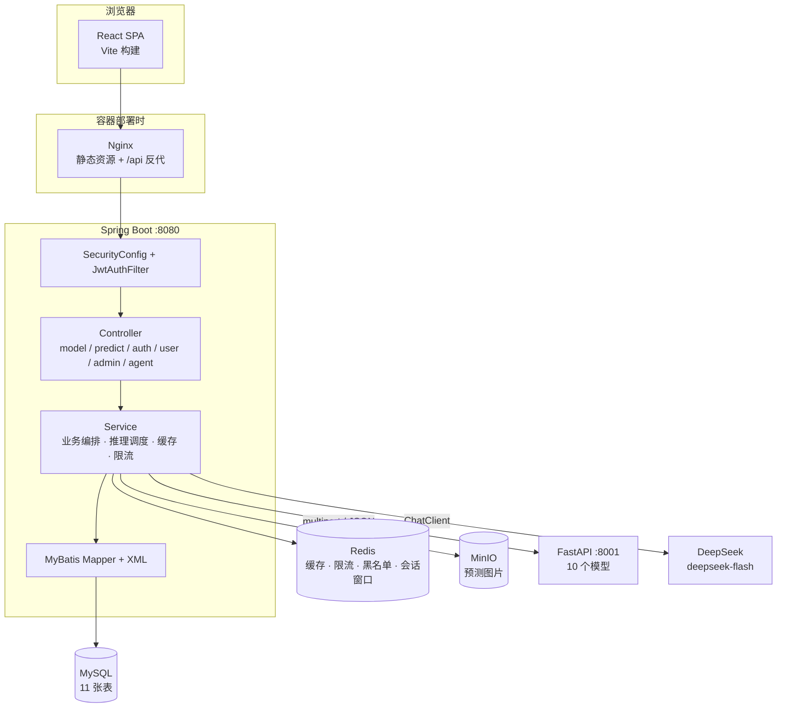

# AI ModelHub

AI 模型体验平台。用户在网页上挑一个模型、传一张图或一段文字，后端校验、限流、落库，Python 服务跑真实的前向计算，结果回到页面上并且能在「个人中心」翻到历史记录。

模型本身不是重点，重点是围绕模型的那一圈工程代码：模型怎么注册和管理、推理请求怎么路由、用户身份怎么校验、文件放在哪里、缓存和限流怎么做、大模型 Agent 怎么在不编数据的前提下调用真实接口。

---

## 目录结构

| 目录 | 内容 |
|---|---|
| `backend/` | Spring Boot 3.5.16 + MyBatis，JDK 17，含 Agent 模块 |
| `frontend/` | React 19 + TypeScript + Vite 7 单页应用 |
| `model-service/` | FastAPI + PyTorch / sklearn / ONNX，10 个模型的推理实现 |
| `sql/` | MySQL 8 建表与迁移脚本 001–013 |
| `deploy/` | Docker Compose 编排与变量模板 |
| `docs/` | 架构、接口、Agent 设计、数据库、安全说明 |

三个进程互相之间只走 HTTP，没有服务注册也没有消息队列。这种结构在小项目里够用，代价是地址要写死在配置里。

---

## 能做什么

**模型管理。** 模型的元数据（名称、类型、算法、准确率、简介、`model_api`）存在 `model_info` 表里，后台可以增删改和上下架。`model_api` 存的是推理服务的 `model_key`（比如 `resnet50`），不是 URL —— 后端按这个 key 拼下游地址，所以新增模型只需要在后台登记一条记录、在 Python 侧注册实现，不用改 Java 代码。

目前接了 10 个模型：图像分类（ResNet-50）、目标检测（YOLOv8）、抠图（U²-Net）、肺部 CT 二分类、花卉识别、情感分析（英文 DistilBERT / 中文 MLP 按语种分流）、中文评论情感（同一套 MLP）、鸢尾花分类（XGBoost）、天气预测、股票收盘价回归。

**在线体验。** 图像、文本、表格三条入口，加一个通用自定义入口。表单会按模型类型切换（图片上传 / 文本框 / 数值字段），提交后结果、置信度、耗时、候选标签一起返回，同时写一条 `predict_record`。

**账号与权限。** 注册、登录、密保问答找回密码、登出。JWT 鉴权，权限分三档：匿名能看到模型列表和详情，登录用户能推理、能管自己的收藏和历史，`admin` 才能进后台。登出会吊销当前令牌，重置密码会让该用户此前签发的令牌全部失效，靠 Redis 黑名单实现。

**个人中心。** 预测历史（按时间倒序，前端一次取回全部，没有分页）、模型收藏（唯一键保证幂等，重复点不会插两条，也不会报错）。

**管理后台。** 模型 CRUD、用户列表、重置密码、操作审计（`@AuditLog` 切面把操作人、参数、成败、耗时写进独立日志）。

**ModelHub Copilot。** 用自然语言查模型、选模型、发起推理。Agent 的数据全部来自工具调用（9 个工具，落到既有 Service 上），推理必须由用户在确认卡片上点「执行」才真正发生。

---

## 技术栈

后端：

| 依赖 | 版本 | 在项目里的作用 |
|---|---|---|
| Spring Boot | 3.5.16 | Web、安全、缓存、Actuator、RestTemplate |
| MyBatis Starter | 3.0.5 | 持久层。Mapper 接口 + XML，`map-underscore-to-camel-case` 打开 |
| Spring AI | 1.1.8 | Agent 的 `ChatClient`、`@Tool` 反射调用、SSE 流式输出 |
| JJWT | 0.12.6 | JWT 签发与验签（HS256，密钥 Base64 解码后 ≥32 字节） |
| Spring Data Redis | Boot 管理 | Spring Cache、滑动窗口限流、令牌黑名单、Agent 上下文窗口、每日配额 |
| MinIO SDK | 8.6.0 | 存预测图片 |
| SpringDoc | 2.8.17 | Swagger UI，dev 开、prod 关 |
| ONNX Runtime | 1.20.0 | 本地跑 BGE-small-zh 向量模型，给 RAG 用 |
| Micrometer + Prometheus | Boot 管理 | dev 暴露指标 |

前端：React 19.2 / Vite 7.3 / TypeScript 5.9 / Tailwind 4.1 / React Router 7 / Zustand 5 / Recharts 3。构建产物用 `vite-plugin-singlefile` 打成单个 `index.html`，部署时只需要一个静态文件。

推理服务：FastAPI 0.115 + Uvicorn，PyTorch 2.0（ResNet / YOLOv8 底座）、Transformers 4.36（BERT）、Ultralytics 8.0、XGBoost + scikit-learn、TensorFlow 2.15（两个 `.h5` 权重）、rembg + onnxruntime（U²-Net）、jieba。

数据库 MySQL 8.0，缓存 Redis 7，对象存储 MinIO。

---

## 系统架构



三处值得说明的地方：

**前端不直连 MinIO。** 图片 URL 走 `GET /api/files/**`，由 `FileProxyController` 从 MinIO 取流再吐给浏览器。这样不用配 CORS 和桶策略，对象存储地址也不用出内网。代价是多一次转发。

**推理路由收在一处。** `PredictController` 不关心下游是哪个模型，统一交给 `ModelGatewayService`；实现类按 `model_api` 分派到 4 个 FastAPI 路径（图像走 `/predict/image`，`bert` 走 `/text/classify`，`xgboost` 走 `/tabular/predict`，其余走 `/predict/custom`）。

**MinIO 只存预测图片。** Agent 上传的附件存在后端本地磁盘（`agent_attachment.storage_key` 记相对路径），不进对象存储。这两个不是同一套东西，读代码时容易混。

---

## 一次图片推理请求经历什么

1. `POST /api/predict/image`，multipart 带 `file` 和 `modelId`，请求头带 JWT。
2. `JwtAuthFilter` 验签，把 `principal` 设成 `Long userId`；`SecurityConfig` 判断该路径需要登录。
3. `ModelInferenceService.checkRateLimit()` 拦一道限流：Redis ZSET + Lua 滑动窗口，20 次 / 60 秒 / 用户。限流放在 Service 而不是 Controller 切面上，是因为 Agent 的推理工具也调同一个方法，额度要一起算。
4. `ModelInferenceService` 查模型：必须存在且 `status = 1`，`model_api` 不能为空。
5. `FileStorageService` 校验大小（≤5MB）和 MIME，传到 MinIO 的 `predictions` 前缀。**MinIO 挂了不中断**，只是最后 `fileUrl` 为空。
6. 调 `POST :8001/predict/image`，同步等结果；下游非 2xx 转成 502。
7. 结果映射 + 计时，`PredictRecordService` 落库，事务提交后清 `user_records::{userId}` 缓存。

文本和表格入口走同一条链路，只是第 5 步没有文件、第 6 步换下游路径。

---

## ModelHub Copilot

Agent 是后端的一个业务域（`com.aimodelhub.agent`，54 个类），不是独立服务。设计文档在 [`docs/AGENT_ARCHITECTURE.md`](docs/AGENT_ARCHITECTURE.md)，这里只说三个关键决定。

**工具拿不到 userId。** `@Tool` 方法签名里没有 `userId` 参数，身份存在请求级的 `AgentToolContext` 里。模型无论怎么拼参数都改不了"我是谁"，从结构上堵掉越权，而不是靠提示词叮嘱。

**推理要走确认。** `prepareInference` 只创建一条 `PENDING` 的 `agent_task` 就返回，不碰模型。真正执行是带 JWT 的 `POST /api/agent/tasks/{id}/confirm`，状态迁移用数据库条件更新（`UPDATE ... WHERE status='PENDING'`，看影响行数），多实例部署和重复点击都不会执行两次。

**推选分两步。** 先用 SQL 从库里取候选模型，再把候选连同用户需求交给 DeepSeek（JSON 模式、温度 0）排序写理由，最后服务端按 id 回查数据库回填展示字段。模型编出来的 id 会被直接丢掉，前端拿到的永远是库里存在的模型。

对话用 SSE 流式返回，事件有 `session` / `token` / `tool_result` / `recommend` / `confirm_required` / `done` / `error`。前端用 `fetch` + `ReadableStream` 解析，因为 `EventSource` 不能带 `Authorization` 头。

---

## 数据库

11 张表，MySQL 8.0，`utf8mb4`。

| 表 | 说明 |
|---|---|
| `sys_user` | 用户、角色、密保问答（BCrypt） |
| `model_info` | 模型元数据，`model_api` 是跨服务调度的依据 |
| `predict_record` | 每次预测的输入摘要、结果、置信度、耗时、图片 URL |
| `favorite_model` | 收藏关系，`uk_user_model` 保证幂等 |
| `agent_session` / `agent_message` | 会话与消息，`tool_payload` 存工具调用快照 |
| `agent_task` / `agent_attachment` | 待确认/已执行任务、会话内上传的文件 |
| `agent_model_profile` | 模型的结构化输入规范（必填字段、示例） |
| `agent_knowledge_document` / `agent_knowledge_chunk` | 知识库文档与分块（含 JSON 向量） |

没有外键。模型删除是逻辑删除（`status = -1`），历史预测记录里的 `model_id` 变成弱引用，这是刻意的：物理删除会带走历史数据。字段清单和索引建议见 [`docs/DATABASE.md`](docs/DATABASE.md)。

---

## 本地运行

### 前置

JDK 17、Maven 3.9+、Node 20+、Python 3.11、MySQL 8.0、Redis 7。MinIO 可选 —— 不装的话预测照样出结果，只是不保存图片。

### 1. 数据库

```bash
for f in sql/0*.sql; do
  mysql -uroot -p --default-character-set=utf8mb4 < "$f" || break
done
```

脚本都是幂等的，重复跑没问题。跑完应该有 2 个用户、10 个模型、11 张表。种子数据里存的是 BCrypt 哈希，演示口令为 `123456`。

### 2. 后端

仓库里没有 `application.yml`（那玩意儿带本机口令，被 `.gitignore` 排掉了），从模板复制一份：

```bash
cp backend/src/main/resources/application-example.yml \
   backend/src/main/resources/application.yml
```

模板里所有敏感项都写成 `${环境变量:占位符}`，可以不改文件、直接用环境变量注入：

| 配置 | 环境变量 |
|---|---|
| 数据库口令 | `MYSQL_ROOT_PASSWORD` |
| MinIO 凭据 | `MINIO_ROOT_USER` / `MINIO_ROOT_PASSWORD` |
| JWT 密钥（`openssl rand -base64 32`） | `JWT_SECRET` |
| Agent 的大模型密钥 | `DEEPSEEK_API_KEY` |

```bash
cd backend
mvn -DskipTests package
java -jar target/ai-modelhub-backend-0.0.1-SNAPSHOT.jar
```

profile 有三个：`dev`（默认，localhost 直连，Swagger 开）、`docker`（主机名用 compose 服务名，口令无默认值）、`prod`（关 Swagger，检测到模板密钥或弱口令直接拒绝启动）。

### 3. 推理服务

```bash
cd model-service
python -m venv .venv && source .venv/Scripts/activate
pip install -r requirements.txt      # 约 3–5 GB，含 PyTorch 和 TensorFlow
uvicorn main:app --host 0.0.0.0 --port 8001
```

模型在后台线程里逐个加载，服务本身立刻可用。`curl :8001/health` 返回 `status`（进程是否活着）和 `models`（每个模型是 `loaded` / `not_loaded` / `error: 原因`）。单个模型失败只记日志，不影响其它模型。

> 只有 5 个基础模型（ResNet-50 / BERT / YOLOv8 / XGBoost / U2Net）在启动时预加载并出现在 `models` 里；另外 5 个自定义模型是懒加载，首次调用时才会加载。

**仓库里只有 `weights/README.md`，一个权重文件都没有。** 详细清单见 [`model-service/weights/README.md`](model-service/weights/README.md)，这里只列关键区别：

| 类别 | 模型 | 需要你做什么 | 缺了会怎样 |
|---|---|---|---|
| 构建时自动下载 | ResNet-50、YOLOv8、英文 DistilBERT | 构建镜像时联网即可 | 启动失败并记 `error` |
| 自动训练 | 鸢尾花（XGBoost） | 什么都不用做（用 sklearn 内置 iris） | 首次调用时现场训练 |
| **必须自备** | 抠图（`u2net.onnx` 168 MB）、肺部 CT（`chest_ct_resnet50.h5` 211 MB）、花卉（`flower_cnn_model.h5` 46 MB） | 放进 `model-service/weights/` | 对应接口 500；U²-Net 返回 503「抠图模型暂不可用」，`/health` 标记 `error`，**不会**自动下载 |
| **必须自备** | 中文情感（`chinese_sentiment_mlp.pkl` 7.33 MB + `chinese_vectorizer.pkl` 375 KB） | 同上，两个文件必须成对 | 见下方单独说明 |
| 自备且依赖数据集 | 天气（878 KB）、股票（1 KB） | 权重 + `Dataset/*.csv`（都不在仓库） | 自动训练失败 → 500 |

中文情感在两个入口的表现不同，容易踩：

- 「文本情感分析」输入中文 → 缺权重时**不报错**，降级成关键词规则，响应里 `modelName` 会写「中文情感（关键词规则）」；
- 「中文评论情感分析」直连 → 缺权重会尝试训练，而训练语料 `Dataset/ChnSentiCorp_htl_all.csv` 不在仓库，直接 500。

所以想看到真正的中文情感判断，必须放那两个 pkl。

肺部 CT、花卉、中文情感、天气、股票这五个模型的权重（以及天气/股票/中文情感训练用的 `Dataset/*.csv`）**都未包含在仓库中**，也没有公开下载地址。使用者需要根据各模型说明自行准备符合要求的文件，并确保具有合法使用授权；也可以直接用 `app/models/` 里对应的训练函数、基于自己合法持有的数据重新训练生成。

U²-Net 缺 `u2net.onnx` 时**不会**联网下载：启动即判定不可用，`/health` 记 `error`，抠图接口返回 503。确实想让它首次加载时自动拉 176 MB，得显式设 `U2NET_ALLOW_DOWNLOAD=true`（默认关闭）。

### 4. 前端

```bash
cd frontend
cp .env.example .env.development
npm install
npm run dev        # http://localhost:5173
```

`VITE_BACKEND_BASE_URL` 指向后端。不配也行：dev 构建默认 `http://localhost:8080`，prod 构建默认同源（走 Nginx 的 `/api` 反代），所以部署到哪台机器都不用改代码。

### 5. Docker

```bash
cd deploy
cp .env.example .env      # 填 MYSQL_ROOT_PASSWORD / MINIO_ROOT_* / JWT_SECRET
docker compose up -d --build
```

> 首次 `--build` 要联网下载约 3 GB 的 Python 依赖和约 370 MB 的模型权重（ResNet-50 / BERT / YOLOv8），实测 20 分钟上下；之后重建走 Docker 缓存，分钟级完成。构建期间终端长时间停留在 pip 下载是正常现象。

6 个服务：`mysql`（宿主 3307）`redis` `minio` `model-service` `backend` `frontend`。compose 对关键变量用 `${VAR:?}`，少填一个就直接报错退出，不会拿示例口令凑合。

`frontend/nginx.conf` 里 `/api/agent/chat` 单独一段关了 `proxy_buffering` 和 `gzip`，不这么做 SSE 会被缓冲成"一直空白、最后一次性出现"。

### 验证

登录后应该能看到 10 个模型；「在线体验」选「智能图像分类」传张图能出识别结果并写进预测历史——这个模型的权重构建镜像时已自动下载，开箱就能用。想用「智能抠图」需要先自备 `u2net.onnx`（见上面权重表），缺权重时接口会明确提示「该模型当前不可用」，不会静默下载。收藏一个模型刷新还在。`http://localhost:8080/docs` 是 Swagger（dev、docker profile 可用，prod 关闭）。

---

## 已知限制

1. 三个服务的地址写死在配置里，换机器要改配置，没有服务发现。
2. 推理是同步调用，模型加载在 Python 进程内，多开实例会重复加载权重，所以没做横向扩容。
3. 限流和令牌吊销都依赖 Redis。Redis 挂了应用还能起、业务还能跑（缓存降级为直查数据库），但限流和吊销会失效。
4. 向量检索是应用层暴力算余弦，4 篇文档、31 个分块时够用。分块上万就得换向量索引。
5. `predict_record` 没有二级索引，数据量上千后用户历史分页会全表扫描。
6. 前端生产构建是单文件，`index.html` 约 1 MB，换的是部署简单。
7. 演示账号的口令在两条路径上是同一个默认值 `123456`：跑 `002_init_seed.sql` 会写入 BCrypt 哈希；没跑 SQL 而库为空时，`DataInitializer` 用 `app.bootstrap.default-user-password`（默认也是 `123456`）建账号。对外部署前请通过 `APP_BOOTSTRAP_DEFAULT_USER_PASSWORD` 覆盖，或在系统里改掉。

---

## 验证状态

文档里的命令和版本号都是对着代码核过的，下面这些是在 Windows + JDK 17.0.14 + Maven 3.9.4 + Node 22.22 上实际跑过的：

| 项目 | 命令 | 结果 |
|---|---|---|
| 后端编译打包 | `mvn -B -DskipTests package` | 通过，119 个源文件，产出可执行 jar |
| 前端依赖与构建 | `npm ci` / `npm run build` | 通过，2716 个模块，`dist/index.html` 1.07 MB（gzip 313 KB） |
| 前端类型检查 | `npx tsc --noEmit` | 无错误 |
| 前端 lint | `npm run lint` | 0 error / 23 warning（都是既有写法问题） |
| Python 依赖 | 比对源码 import 与 `requirements.txt` | 16 个第三方模块均已声明 |
| SQL 脚本 | 静态校验建表列 / INSERT 列 / ALTER 目标 | 11 张表，无悬空引用 |
| Compose | YAML 解析 + 服务依赖与构建上下文校验 | 6 个服务，Dockerfile 均在 |

**当时没跑、后来补齐的**（2026-11 起，均在隔离环境执行：Docker 临时起 MySQL 3307 / Redis 6380 / MinIO 9000，从未连接本机开发库）：

| 项目 | 结果 |
|---|---|
| `mvn -B test` | 44 个用例全部通过（8 个测试类，0 失败 0 跳过） |
| 后端启动 | 13 秒就绪，日志 0 条 ERROR；13 个 SQL 脚本空库重复执行无副作用 |
| `docker compose up -d --build` | 6 容器全部 healthy；空库自动初始化出 11 表 / 2 用户 / 10 模型 |
| 浏览器端到端 | 登录 → 模型页 → 上传图片识别「雏菊 69%」→ 收藏 → 管理后台，0 控制台报错 |
| Agent | 无 `DEEPSEEK_API_KEY` 时明确提示；SSE 逐块流式与各类错误映射经本地 mock 验证 |
| 权重缺失行为 | U²-Net 缺权重时健康检查标 `error`、接口 503，不联网、不留缓存；其余模型不受影响 |

执行细节与验证结论以仓库提交历史中的测试记录为准；本阶段验证均在与开发库完全隔离的环境里完成，重复执行 §本地运行 与 §Docker 的步骤即可复现。

---

## 常见问题

**后端启动报找不到数据源。** 忘了从 `application-example.yml` 复制 `application.yml`。

**prod 启动直接失败，日志说密钥不安全。** `JWT_SECRET` 还是模板值或者弱口令。用 `openssl rand -base64 32` 生成。

**Agent 回复「AI 助理尚未配置大模型密钥」。** 没设 `DEEPSEEK_API_KEY`。设完重启后端，别写进 yml 提交。具体技术原因在后端日志里（`AgentAiConfig` 与 `AgentChatService` 都会打）。

**预测 502 或超时。** 推理服务没起，或者模型还在加载。`curl :8001/health` 看一下。

**预测成功但图片打不开。** MinIO 没起，或者 `app.file-proxy.base-url` 不是浏览器能访问的地址。跨机部署用 `FILE_PROXY_BASE_URL` 覆盖。

**上传失败但文件明明不到 5MB。** 上限写了四个地方：`max-file-size`、`max-request-size`、`FileStorageService.MAX_FILE_SIZE`、推理服务的 `_MAX_UPLOAD_MB`，还有 nginx 的 `client_max_body_size`。改一处不算改完。

**Agent 回复卡很久然后一次性全出来。** Nginx 把 SSE 缓冲了。检查 `/api/agent/chat` 那段 location。

**中文乱码。** 每个 SQL 文件首行都写了 `SET NAMES utf8mb4`；存量数据可以用 `013_fix_mojibake.sql` 修。

**换端口部署后登录报 403 / `Invalid CORS request`。** 前端不在 80 端口、或前后端分域名时，浏览器会带 `Origin`，Spring 会按白名单校验。把前端地址加到 `APP_CORS_ALLOWED_ORIGINS`（逗号分隔）再重启后端即可。不要填 `*`。

**后台列表里有无效模型。** `status = -1` 的逻辑删除记录，历史预测还要用它，属于预期。

**端口不是 8080。** 环境里有 `SERVER_PORT` 或 `SERVER__PORT`（CI 和某些 IDE 会注入）。显式指定 `--server.port=8080`。

---

## 截图

暂无。补的时候放 `docs/images/`，建议覆盖首页、模型中心、在线体验、个人中心、管理后台、Agent 对话六个页面。截图前把地址栏和账号信息裁掉。

---

## 文档

| 文档 | 内容 |
|---|---|
| [`docs/ARCHITECTURE.md`](docs/ARCHITECTURE.md) | 后端分层、三条调用链、事务与异常处理、缓存与限流 |
| [`docs/API.md`](docs/API.md) | REST 接口、错误码、权限矩阵、限流规则 |
| [`docs/AGENT_ARCHITECTURE.md`](docs/AGENT_ARCHITECTURE.md) | Agent 的类结构、工具调用、确认状态机、RAG、SSE |
| [`docs/AGENT_API.md`](docs/AGENT_API.md) | Agent 接口与 SSE 事件格式 |
| [`docs/DATABASE.md`](docs/DATABASE.md) | 表结构、脚本顺序、索引建议 |
| [`docs/SECURITY.md`](docs/SECURITY.md) | 凭据管理、鉴权、上传限制、上线检查清单 |

---

## 说明

这是一个学习性质的项目，用来把「模型服务化」这条链路上的工程问题走一遍。推理结果不构成任何建议，尤其肺部 CT 那个模型只是迁移学习的演示，不能用于临床。

仓库里不含真实口令、密钥和用户数据。本地配置从 `application-example.yml` 复制后自己填，密钥走环境变量。
