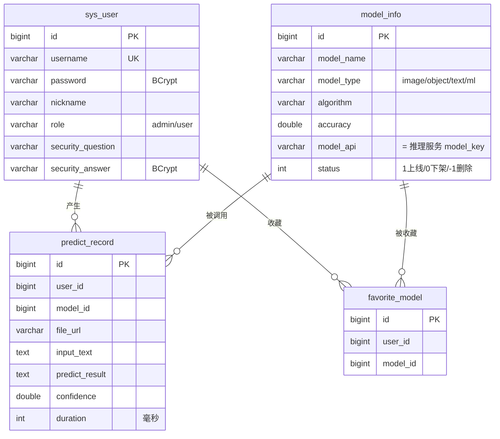

# 数据库设计说明

> 本文对应 `sql/001` – `sql/013` 的真实建表脚本，字段名与类型均取自 SQL 原文。
> MySQL 8.0，字符集 `utf8mb4`，全部脚本首行 `SET NAMES utf8mb4`，且均为幂等写法（可重复执行）。

---

## 1. 脚本执行顺序

| 文件 | 作用 | 是否幂等 |
|---|---|---|
| `001_init_schema.sql` | 建库 + 4 张核心表（`sys_user` / `model_info` / `predict_record` / `favorite_model`） | `CREATE TABLE IF NOT EXISTS` |
| `002_init_seed.sql` | 演示账号 `admin` / `demo`（BCrypt 哈希）+ 初始模型数据 | `ON DUPLICATE KEY UPDATE`，只更新昵称 |
| `003_fix_null_create_time.sql` | 修复历史数据中为 `NULL` 的时间列 | 批量 `UPDATE` |
| `004_add_security_fields.sql` | 补充密保字段（`security_question` / `security_answer`） | 条件 `ALTER` |
| `005_add_u2net_model.sql` | 追加 U2Net 抠图模型元数据 | `ON DUPLICATE KEY UPDATE` |
| `006_fix_predict_record_columns.sql` | 修正 `predict_record` 列定义 | 条件 `ALTER` |
| `007_add_custom_models.sql` | 追加自定义模型（天气 / 股票 / 中文情感等） | `ON DUPLICATE KEY UPDATE` |
| `008_model_descriptions.sql` | 补全模型描述文案 | `UPDATE` |
| `009_agent_schema.sql` | `agent_session` / `agent_message` | `IF NOT EXISTS` |
| `010_agent_model_profile.sql` | `agent_model_profile` + 10 条输入规范 | `IF NOT EXISTS` |
| `011_agent_task_attachment.sql` | `agent_attachment` / `agent_task` | `IF NOT EXISTS` |
| `012_agent_knowledge.sql` | `agent_knowledge_document` / `agent_knowledge_chunk` | `IF NOT EXISTS` |
| `013_fix_mojibake.sql` | 修复 Docker 首次初始化时的中文乱码存量数据 | `UPDATE` |

Docker 部署时 `sql/` 会挂载到容器的 `/docker-entrypoint-initdb.d`，**只在新数据卷首次创建时执行**；
已有数据卷需要手动补跑新增脚本。

---

## 2. 核心业务表（4 张）

### 设计要点

- **`model_info.model_api` 存的是推理服务的 `model_key`，不是 URL。**
  后台新增模型时只填 key（如 `resnet50`），`FastApiModelGateway` 拼出真实地址，
  因此新增模型不需要改后端代码。
- **模型删除是逻辑删除**（`status = -1`），`predict_record` 里的 `model_id` 变成弱引用，
  历史记录仍然可以展示模型名。
- **无外键约束**：这是项目现状。删除模型时不级联，避免历史预测记录被连带删除；
  代价是一致性靠应用层保证。
- **`favorite_model` 有唯一键 `uk_user_model(user_id, model_id)`**，
  配合 `INSERT IGNORE` 实现幂等收藏。

---

## 3. Agent 相关表（7 张）

| 表 | 作用 | 关键字段 |
|---|---|---|
| `agent_session` | 会话 | `user_id`（服务端从 JWT 写入）、`title`、`message_count`、`last_message_at`、`status` |
| `agent_message` | 消息 | `session_id`、`role`（USER/ASSISTANT/TOOL）、`content`、`tool_name`、`tool_payload`(JSON) |
| `agent_task` | 待确认 / 已执行的推理任务 | `task_no`（对外业务号）、`task_status`、`input_type`、`input_payload`、`attachment_id`、`result_payload`、`record_id` |
| `agent_attachment` | 会话内上传的文件 | `storage_key`（只存路径，不存二进制）、`status`（TEMP/USED） |
| `agent_model_profile` | 模型的结构化输入规范 | `model_id`、`input_type`、`required_fields`(JSON)、`example_input` |
| `agent_knowledge_document` | 知识库文档 | `source_type`（SEED/UPLOAD）、`char_count`、`chunk_count` |
| `agent_knowledge_chunk` | 文档分块 + 向量 | `doc_id`、`chunk_index`、`content`、`embedding`(JSON)、`embedding_model`、`embedding_dim` |

**为什么工具调用结果要落库**：`agent_message.tool_payload` 保存工具入参/出参快照，
排查「模型为什么这么回答」时不需要重新调一次大模型，也让上下文自愈（Redis 丢失后从 MySQL 回填）成为可能。

**为什么向量存在 MySQL 的 JSON 列**：本项目只用 4 篇内置文档、约 31 个分块，
暴力计算余弦相似度的成本远低于引入向量数据库带来的运维复杂度。
分块数量增长到万级时应替换为专用向量索引。

---

## 4. 索引与容量建议

| 现状 | 建议 |
|---|---|
| `predict_record` 无二级索引 | 数据量上千后补 `idx_user_time(user_id, create_time)`，用户历史分页会走全表扫描 |
| `model_info.model_name` 无唯一约束 | 允许重名，判重在应用层（目前未做） |
| `agent_message.session_id` 无索引 | 会话消息分页按 `session_id + id` 查询，量大时建议补复合索引 |
| `agent_knowledge_chunk` 全文索引 | 由 `009`/`012` 中的 `FULLTEXT` + ngram 解析器提供，用于中文全文检索 |

---

## 5. 与缓存的关系

MySQL 是唯一事实来源，Redis 只做加速，键前缀按 profile 区分（`aimh:dev:` / `aimh:docker:` / `aimh:prod:`）。

| 缓存 | 键 | TTL | 失效 |
|---|---|---|---|
| 在线模型列表 | `models::online` | 5 min（dev） | 模型写操作 `@CacheEvict` |
| 模型详情 | `model_detail::{id}` | 10 min | 同一模型写操作 |
| 面板概览 | `dashboard_overview::overview` | 2 min | 模型写操作 |
| 用户历史 | `user_records::{userId}` | 1 min | 事务提交后清 |

Redis 不可用时不抛错：`CacheErrorHandler` 降级为直查数据库，业务仍可用，
但限流与 JWT 黑名单会失效（见 `docs/SECURITY.md`）。
